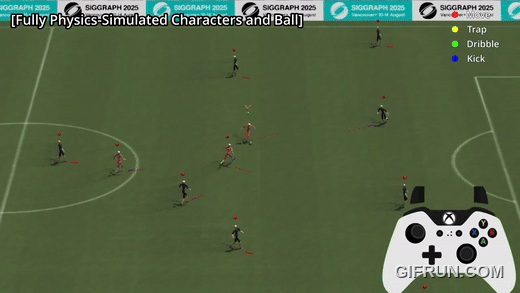

# PhysicsFC: Learning User-Controlled Skills for a Physics-Based Football Player Controller

[](https://youtu.be/OQjIdFQ0g20?si=oeR0Rjspv9ZnEu46)

ACM TOG / SIGGRAPH 2025

[[project]](https://cgrhyu.github.io/publications/2025-physicsfc.html) [[publisher]](https://dl.acm.org/doi/10.1145/3731425) [[arXiv]](https://arxiv.org/abs/2504.21216) [[Slides(PDF)]](https://gitcgr.hanyang.ac.kr/publications/2025-physicsfc/physicsfc-siggraph-presentation.pdf) [[Slides(PPTX)]](https://gitcgr.hanyang.ac.kr/publications/2025-physicsfc/physicsfc-siggraph-presentation.pptx) [[poster]](https://gitcgr.hanyang.ac.kr/publications/2025-physicsfc/physicsfc-etech-intdis-poster.pdf)

**PhysicsFC** controls physically simulated football players — dribbling, trapping, moving, and
kicking — from real-time user input via joystick, with smooth, agile transitions between skills
(**Skill Transition-Based Initialization**, STI) managed by a finite-state machine
(**PhysicsFC FSM**). This repository includes an interactive demo: a single agent traps an
incoming ball, then chains into dribbling and kicking.

PhysicsFC builds upon, and borrows code from, [CALM](https://github.com/NVlabs/CALM) (Conditional
Adversarial Latent Models, Tessler et al., 2023).

&nbsp;

## Installation

1. Create a Python 3.8 environment (required by Isaac Gym's prebuilt bindings) and install
   PyTorch with a CUDA build matching your GPU driver:
   ```
   conda create -n physicsfc python=3.8 -y
   conda activate physicsfc
   conda install pytorch==1.10.0 torchvision==0.11.0 torchaudio==0.10.0 cudatoolkit=11.3 -c pytorch -y
   ```
   (Verified working with `torch==1.10.0`/`cudatoolkit=11.3`; other CUDA-matched torch builds
   should also work as long as `torch.cuda.is_available()` returns `True`.)
2. Download Isaac Gym from the [website](https://developer.nvidia.com/isaac-gym), then install it
   into the same environment:
   ```
   pip install -e <path_to_isaacgym>/python
   ```
   Installing PyTorch first (step 1) avoids Isaac Gym's `setup.py` pulling in an unrelated
   CPU-only/mismatched torch build via its own `torch>=1.8.0` dependency.
3. Install the remaining dependencies for this repo:
   ```
   pip install -r requirements.txt
   ```
   (`torch`/`torchvision`/`torchaudio` are intentionally omitted here — already installed via
   conda in step 1.)

Separately, two more things you'll need before training/testing:

**Pretrained checkpoints.** Trained model checkpoints (`*.pth`) are not included in this
repository. Download them from [this Google Drive folder](https://drive.google.com/drive/folders/1iFXCy_skBawjVVPKt8x6fhd3-w1Wb6-w?usp=drive_link)
and place them under `calm/calm_exp/checkpoints/<skill>/`.

**Motion data.** The football motions used to train PhysicsFC's skills were retargeted from the
[AA Soccer Mega Animations Pack](https://assetstore.unity.com/packages/3d/animations/aa-soccer-mega-animations-pack-241419)
(Unity Asset Store). Raw motion clips are not included in this repository — see
[Motion Retargeting](#motion-retargeting) if you want to retarget your own motion data.

&nbsp;

## Training

PhysicsFC uses a two-level training scheme: a single, shared **low-level policy**
that reproduces football motions from a latent code, and one **skill policy** per
skill (move / dribble / trap / kick) that outputs a latent code to the frozen low-level policy to
accomplish that skill's task.

### Step 1 — Low-Level Policy Pre-Training

The low-level policy is trained to imitate the football motion dataset:
```
python calm/run.py --task HumanoidAMPGetup --cfg_env calm/data/cfg/humanoid_calm.yaml --cfg_train calm/data/cfg/train/rlg/calm_humanoid.yaml --motion_file blackhole/motions/soccer_90.yaml --num_envs 4096 --headless --track
```
<!-- TODO(open): confirm the exact motion dataset yaml used to pretrain the released low-level policy checkpoint
     — several variants exist under blackhole/motions/ (soccer_90.yaml, soccer_90_with_ground.yaml,
     soccer_90_locomotion*.yaml, ...); soccer_90.yaml is the best evidence found so far
     (hardcoded reference in learning/hrl_players.py) but has not been confirmed as the final one. -->
- `--motion_file` points to the dataset of football motion clips the low-level policy should learn to reproduce
  (see [Motion Retargeting](#motion-retargeting) for how these clips are produced). It can be a
  single `.npy` clip or a `.yaml` dataset listing several clips.
- `--num_envs` is required for an actual training run — `calm/data/cfg/humanoid_calm.yaml`'s
  built-in `numEnvs: 16` is only meant for quick viewing/testing (e.g. the
  [Motion Retargeting](#motion-retargeting) section's `HumanoidViewMotion` example) and is too
  small to satisfy `calm_humanoid.yaml`'s `minibatch_size: 16384` (training asserts
  `batch_size % minibatch_size == 0`, where `batch_size = horizon_length(32) * num_envs`) —
  `--num_envs` must be a multiple of 512; 4096 is confirmed to work.
- `--headless` disables visualization; `--track` enables experiment tracking via Weights & Biases.
  Remove `--headless` to watch the simulation.
- Checkpoints are saved periodically to `output/`, alongside a Tensorboard log.

### Step 2 — Skill-Specific Policies

Each skill policy is trained against the frozen low-level policy checkpoint from Step 1:
```
python calm/run.py --task HumanoidMove --cfg_env calm/data/cfg/soccer_hlc/humanoid_move.yaml --cfg_train calm/data/cfg/train/rlg/hrl_humanoid.yaml --llc_checkpoint calm/calm_exp/checkpoints/llc/default.pth --headless --track
```
- `--llc_checkpoint` specifies the pretrained low-level policy from Step 1.

The four skills and their corresponding task/config combinations:

| Skill | `--task` | `--cfg_env` | `--cfg_train` |
|---|---|---|---|
| move | `HumanoidMove` | `calm/data/cfg/soccer_hlc/humanoid_move.yaml` | `calm/data/cfg/train/rlg/hrl_humanoid.yaml` |
| dribble | `HumanoidDribble` | `calm/data/cfg/soccer_hlc/humanoid_dribble.yaml` | `calm/data/cfg/train/rlg/hrl_humanoid.yaml` |
| trap | `HumanoidTrapping_3` | `calm/data/cfg/soccer_hlc/humanoid_trapping_3.yaml` | `calm/data/cfg/train/rlg/hrl_humanoid.yaml` |
| kick | `HumanoidBallPos_1` | `calm/data/cfg/soccer_hlc/humanoid_ball_pos_task_1.yaml` | `calm/data/cfg/train/rlg/hrl_humanoid.yaml` |

&nbsp;

## Testing

### Testing an Individual Skill

Use `--test` with the matching checkpoint from the table above, e.g. for dribble:
```
python calm/run.py --test --task HumanoidDribble --num_envs 16 --cfg_env calm/data/cfg/soccer_hlc/humanoid_dribble.yaml --cfg_train calm/data/cfg/train/rlg/hrl_humanoid.yaml --motion_file <path_to_motion_or_dataset> --llc_checkpoint calm/calm_exp/checkpoints/llc/default.pth --checkpoint calm/calm_exp/checkpoints/dribble/87.pth
```
For other skills, swap `--task`, `--cfg_env`, and `--checkpoint` using the table in
[Training](#training). Verified end-to-end with the environment from [Installation](#installation):
the process loads both checkpoints, steps the simulation, and logs a `reward: ... steps: ...` line
per episode.

- **Requires a joystick/gamepad for movement and skill control** (see `calm/utils/gamepad.py`) —
  there is no joystick-free way to play.

### Running the Interactive Demo

The interactive demo combines the low-level policy and all four skill policies into a live, joystick-controlled
single-character session:
```
python calm/fifa.py
```
- **Requires a joystick/gamepad for movement and skill control** (see `calm/utils/gamepad.py`) —
  there is no joystick-free way to play. The keyboard is only used for `SPACE` (restart) and
  `ESC` (quit), not for controlling the player.
- Loads checkpoints from `calm/calm_exp/checkpoints/{llc,move,dribble,trap,kick}/` by default. The controlled player starts each round in a trap scenario — a ball is
  launched toward them — and can chain into dribbling and kicking via the joystick; `SPACE`
  restarts with a new trap scenario.
- Other checkpoints can be passed with `--llc_checkpoint`, `--move_checkpoint`, `--dribble_checkpoint`,
  `--trap_checkpoint` and `--kick_checkpoint`. Each skill's version (original or `*_Fix`) is detected from the
  checkpoint's observation size (dribble 14 / 12, kick 10 / 13, trap 15 / 17, or 20 with `POST_TARGET_VEL`).
  The Fix skills were trained with a different ball, so add `--ball_profile linear_damping_and_mjfriction`:
  ```
  python calm/fifa.py --ball_profile linear_damping_and_mjfriction \
      --dribble_checkpoint output/<dribble_fix_run>/nn/<run>.pth \
      --kick_checkpoint output/<kick_fix_run>/nn/<run>.pth \
      --trap_checkpoint output/<trap_fix_run>/nn/<run>.pth
  ```
  With a Fix kick, the kick and pass target ranges come from `humanoid_kick_fix.yaml`. A ground pass then aims at
  elevation 0. With a trap that uses `POST_TARGET_VEL`, the post-trap target ball velocity follows the left stick,
  with the maximum speed from `POST_TAR_SPEED_MAX`.

&nbsp;

## Motion Retargeting

PhysicsFC's football motions are retargeted from the
[AA Soccer Mega Animations Pack](https://assetstore.unity.com/packages/3d/animations/aa-soccer-mega-animations-pack-241419)
(Unity Asset Store) onto the AMP humanoid used by this repo. This requires the Autodesk FBX Python
SDK — follow Autodesk's [installation instructions](https://help.autodesk.com/view/FBX/2020/ENU/?guid=FBX_Developer_Help_scripting_with_python_fbx_installing_python_fbx_html)
before continuing.

1. Split the combined animation pack FBX into per-clip FBX files:
   ```
   cd datasets
   python fbx_converter.py
   cd ..
   ```
   (expects `AA_Soccer_Mega_Animations_Pack.fbx` in `datasets/`; writes individual clips to
   `datasets/soccer_mega_pack/`.)
2. Import each FBX clip into poselib's motion format:
   ```
   python calm/poselib/fbx_importer.py
   ```
3. Retarget the imported clip onto the AMP humanoid skeleton:
   ```
   cd calm/poselib
   python retarget_motion.py
   cd ../..
   ```
   `retarget_motion.py` loads its configuration from `data/configs/retarget.json` — edit it to
   match the motion data you want to retarget, then re-run the script. 
4. Group the retargeted `.npy` clips into a dataset `.yaml` file (a list of `{file, weight}`
   entries) using `datasets/motions/data_config.ipynb`

To visualize a single motion clip or a dataset:
```
python calm/run.py --test --task HumanoidViewMotion --num_envs 2 --cfg_env calm/data/cfg/humanoid_calm.yaml --cfg_train calm/data/cfg/train/rlg/calm_humanoid.yaml --motion_file <path_to_motion_or_dataset>
```

&nbsp;

## Citation

If you find PhysicsFC useful for your research, please consider citing:
```bibtex
@article{10.1145/3731425,
  author    = {Kim, Minsu and Jung, Eunho and Lee, Yoonsang},
  title     = {PhysicsFC: Learning User-Controlled Skills for a Physics-Based Football Player Controller},
  year      = {2025},
  volume    = {44},
  number    = {4},
  issn      = {0730-0301},
  url       = {https://doi.org/10.1145/3731425},
  doi       = {10.1145/3731425},
  journal   = {ACM Trans. Graph.},
  month     = jul,
  articleno = {130},
  numpages  = {21},
}
```

&nbsp;

## Reference

This codebase builds upon and borrows code from [CALM](https://github.com/NVlabs/CALM)
(Conditional Adversarial Latent Models, Tessler et al., 2023), which we use as the physics-based
motion embedding foundation for reproducing football motions. Simulation is powered by
[Isaac Gym](https://developer.nvidia.com/isaac-gym), and reinforcement learning by
[rl_games](https://github.com/Denys88/rl_games).

See [License.txt](License.txt) for license information.
